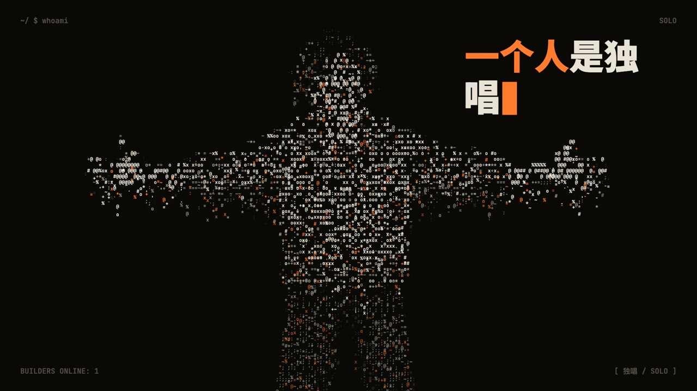
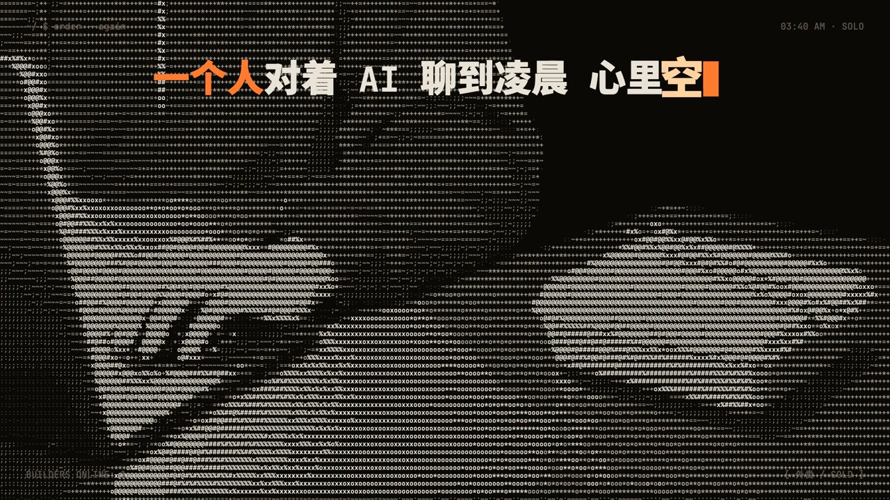
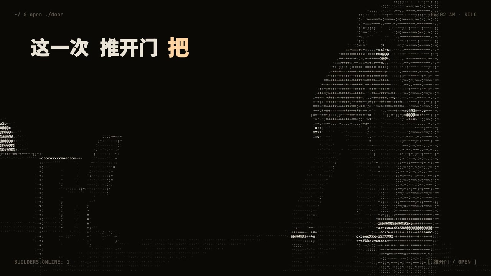
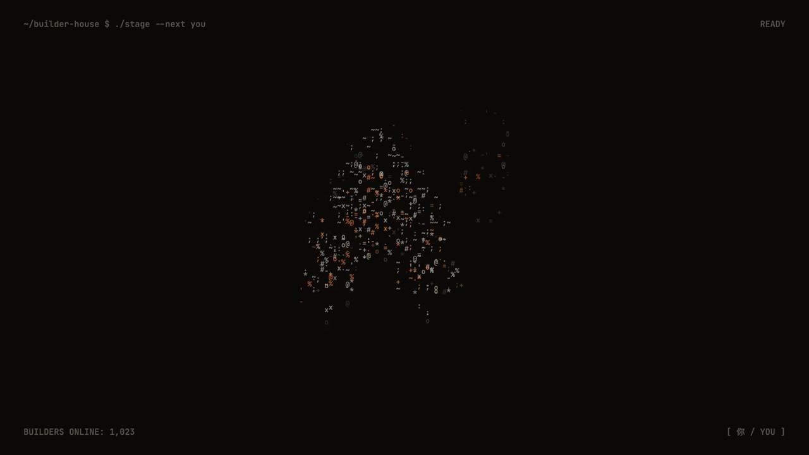
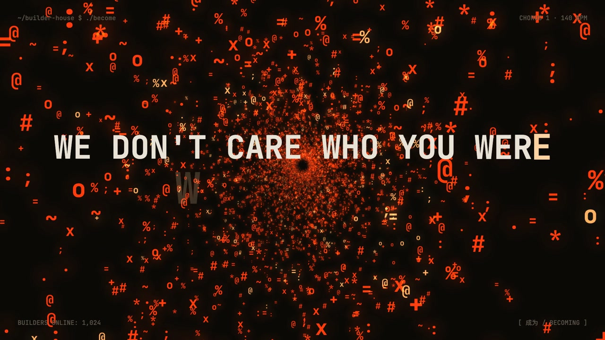
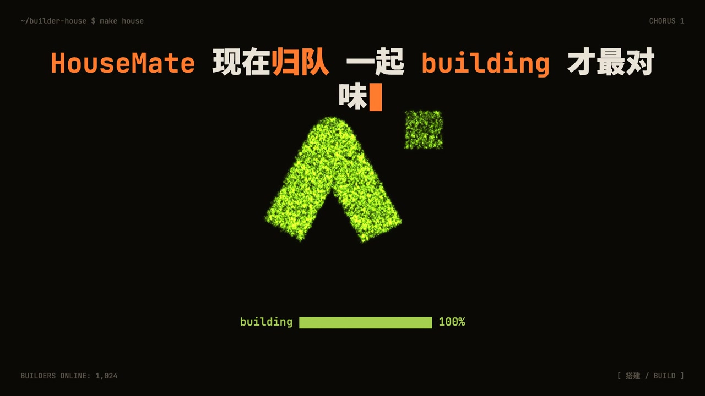

# Claude Video Skills

**用 Claude / Opus，把想法做成视频。**

持续更新的原创视频 skill 合集，首发 **字符人物 MV**：让人物在字符世界里表演、互动，用音乐讲故事。
每种风格都有制作流程、渲染工具和真实作品示例，未来会加入更多视频类型。

**简体中文** · [English](README.en.md)



## 一行安装

```bash
npx skills add https://github.com/DocJlm/claude-video-skills --skill ascii-character-mv
```

需要 Node.js **22.20+**，按提示选择 Claude Code、Codex 等目标 agent，默认安装到当前项目。

安装后，直接对 agent 说：

```text
用 ascii-character-mv 给这首歌做 MV：<歌曲路径>。
歌词：<歌词路径>。
以字符人物的动作、表演和群像叙事为主，先一次问我一个问题确认需求。
```

安装命令负责安装 skill 和配套资源。首次制作时，agent 会自动运行环境检查并准备局部渲染依赖。
当前运行环境为 **macOS、Node.js 20+、ffmpeg、uv、python3**；缺少系统工具时会提示安装方法。
完整的环境与制作步骤见 [skill 说明](skills/ascii-character-mv/SKILL.md)。

## 先看效果：《成为谁》

**人物是主角，粒子是可选的表达。**

角色从独自面对屏幕，到独唱、合唱与群像互动；动作帧、逐字歌词和音乐卡点共同推进故事。
以下约 20 秒预览以人物镜头为主，末尾保留短暂的隧道效果作为点缀。

https://github.com/user-attachments/assets/0c9a12df-ff8d-4894-abad-3ae1b3828219

<table>
<tr>
<td><br>角色 · Character</td>
<td><br>动作 · Action</td>
<td><br>独唱 · Solo</td>
</tr><tr>
<td><br>群像 · Ensemble</td>
<td><br>可选隧道 · Optional tunnel</td>
<td><br>可选汇聚 · Optional convergence</td>
</tr>
</table>

《成为谁》为 AI Builder House 制作。原片使用手写镜头代码，当前 skill 的工具链和镜头库从该作品提炼。
原片的“字符星火”方案是该作品的设计选择；新项目可完全不使用粒子。

## 已发布的 skill

| Skill | 核心能力 | 可选效果 |
| --- | --- | --- |
| [字符人物 MV · ascii-character-mv](skills/ascii-character-mv/README.md) | 字符人物、四格动作帧、角色表演与群像、逐字歌词、音乐卡点、原生横竖版 | 终端 HUD、星火、隧道、粒子汇聚 |

适合歌曲 MV、音乐驱动的社区宣传片、毕业季与乐队作品。
角色、情节、动作、配色与效果按主题重新设计，不照搬示例。

## 制作流程

需求访谈 → 歌曲分析 → 人物与叙事方向 → 动作素材与分镜 → 关键帧确认 → 540p 样片 → 成片交付。

- [风格手册](skills/ascii-character-mv/docs/01-风格手册.md)
- [《成为谁》原作制作记录](skills/ascii-character-mv/examples/成为谁/README.md)
- [验证说明](VALIDATION.md)

[MIT License](LICENSE)
