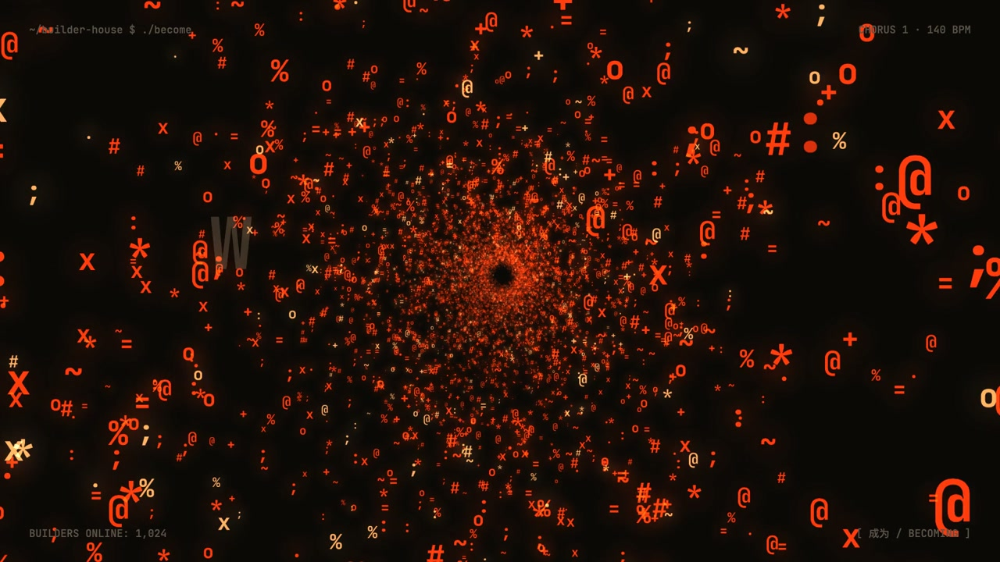
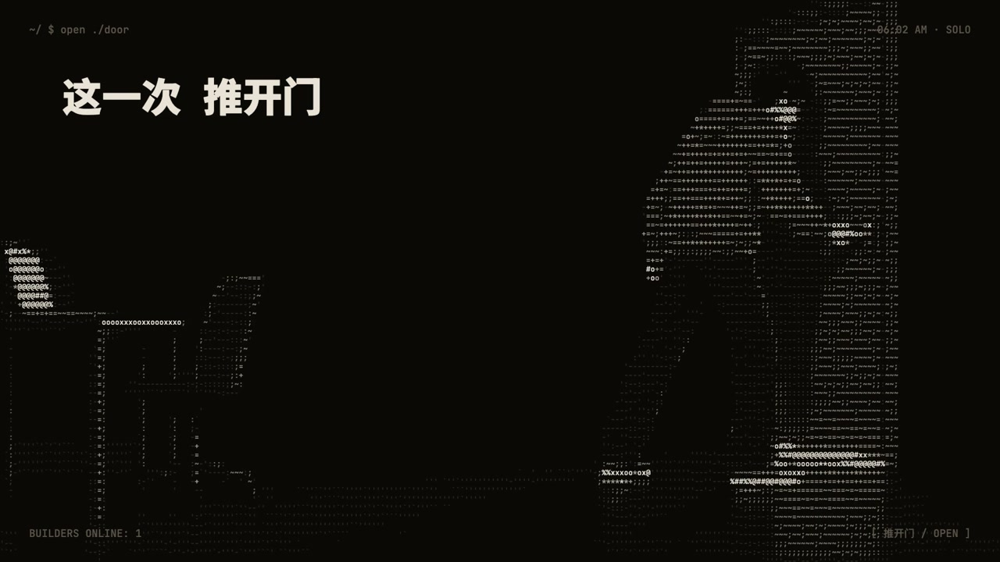
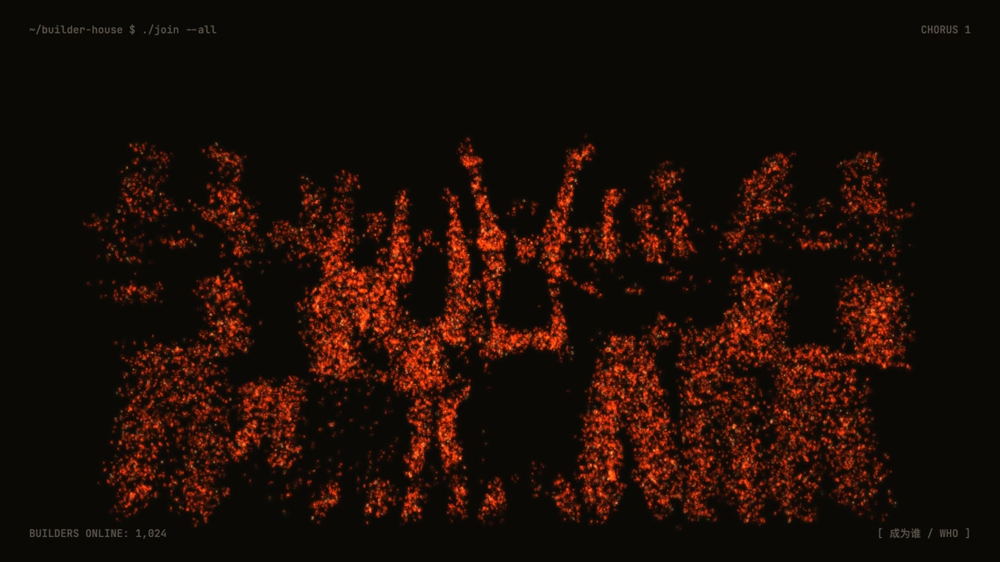
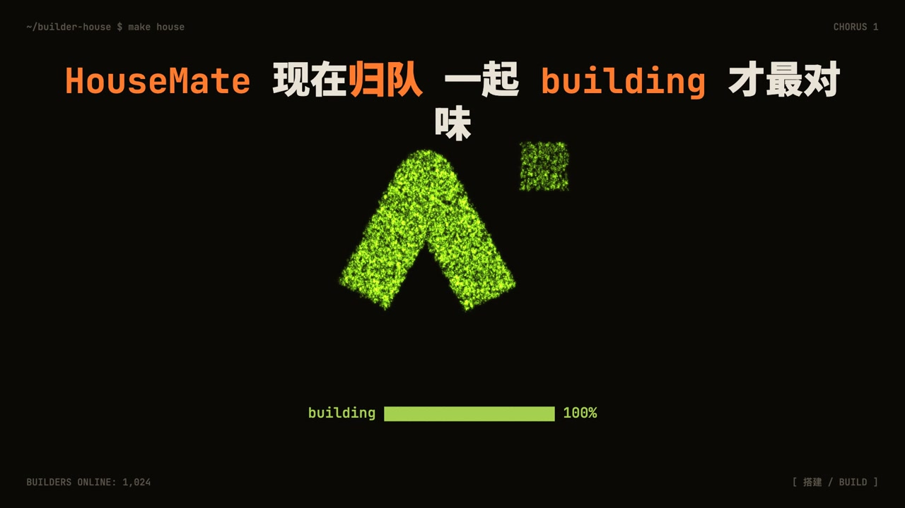
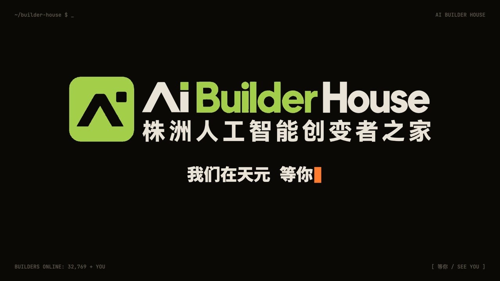

# Claude Video Skills

**用 Claude / Opus，把想法做成视频。**

持续更新的原创视频 skill 合集：每种风格都配有制作流程、渲染工具和作品示例。
首发 **字符星火 MV**，后续会加入更多视觉风格和视频类型。

**简体中文** · [English](README.en.md)　|　[下载首个 skill](https://github.com/DocJlm/claude-video-skills/releases/download/v0.1.0/ascii-ember-mv-v0.1.0.zip)

[](https://github.com/DocJlm/claude-video-skills/releases/tag/v0.1.0)

**[▶ 播放《成为谁》20 秒副歌预览](https://github.com/DocJlm/claude-video-skills/releases/tag/v0.1.0)** · 720p / MP4 / 含声音

https://github.com/user-attachments/assets/419f0eaa-f36e-4587-91b8-fa8460cad893

## 先看效果：《成为谁》

一人、一群人，最后汇成一间房。字符人物、逐字歌词和终端 HUD 贯穿主歌，
副歌进入三维字符火星空间，粒子从爆散、隧道走向汇聚。

<table>
<tr>
<td><br>字符人物 · ASCII character</td>
<td><br>冲破 · Breakthrough</td>
<td><br>火星隧道 · Ember tunnel</td>
</tr><tr>
<td><br>三维字符空间 · 3D glyph space</td>
<td><br>火星汇聚 · Convergence</td>
<td><br>终端片尾 · End card</td>
</tr>
</table>

这是为 **AI Builder House（株洲人工智能创变者之家）** 制作的 MV。
原片使用手写镜头代码，当前 skill 的镜头库与流程从该作品中提炼而来；
以上展示不代表现有 skill 一键生成了原片，也不保证逐帧复现原片。

[制作记录](skills/ascii-ember-mv/examples/成为谁/制作记录.md) · [创作方案](skills/ascii-ember-mv/examples/成为谁/最终方案_v2.md)

## 已发布的 skill

| Skill | 风格与能力 | 适合制作 |
| --- | --- | --- |
| [字符星火 MV · ascii-ember-mv](skills/ascii-ember-mv/README.md) | 字符人物、3D 字符火星、逐字歌词、终端 HUD、卡点转场；横竖版分开构图 | 歌曲 MV、音乐驱动的社区宣传片、毕业季与乐队作品 |

同一种风格可以根据主题重新设计叙事、人物、配色与汇聚对象。
当前只有这一种风格；未来的新风格会作为独立 skill 加入。

## 快速开始

### 1. 获取 skill

下载 [独立 ZIP](https://github.com/DocJlm/claude-video-skills/releases/download/v0.1.0/ascii-ember-mv-v0.1.0.zip) 并解压，或克隆整个仓库：

```bash
git clone https://github.com/DocJlm/claude-video-skills.git
cd claude-video-skills/skills/ascii-ember-mv
```

ZIP 用户进入解压后的 `ascii-ember-mv` 文件夹执行后续命令。

### 2. 检查环境

当前支持 **macOS**，需要 **Node.js 20+、ffmpeg、uv、python3**。

```bash
bash tools/doctor.sh
```

首次运行会在 skill 内安装 npm 依赖，并通过 Playwright 安装 Chromium 到用户缓存。
不全局安装 npm 包。首次分析歌曲还需要下载 Python 依赖与 Whisper 模型。

### 3. 把歌曲交给 agent

在 skill 文件夹打开 Claude Code，把下面这段话发给它：

```text
先完整阅读当前目录的 SKILL.md。
用 ascii-ember-mv 给这首歌制作 MV：<歌曲的绝对路径>。
歌词：<歌词文件的绝对路径>。
先一次问我一个问题，确认主题、人物、配色以及横版/竖版需求。
```

Codex、Cursor 等 coding agent 可先读取本 skill 的 `AGENTS.md`。
这些工具需要具备本地命令行与文件访问能力；未验证所有客户端和模型组合。
有生图能力时可生成角色动作帧；没有时可手动提供图片，或选择无人物版本。

## 制作流程

需求访谈 → 歌曲分析 → 选择叙事方向 → 分镜与人物素材 → 关键帧确认 → 540p 样片 → 成片交付。

引擎读取 `storyboard.json`，可复用语义时间标记、镜头类型及横竖版布局。
歌曲、歌词、人物图和 logo 由使用者提供或生成，不包含在下载包中。

- [Skill 完整说明](skills/ascii-ember-mv/SKILL.md)
- [风格手册](skills/ascii-ember-mv/docs/01-风格手册.md)
- [《不系舟》38 秒片段示例](skills/ascii-ember-mv/examples/不系舟片段/README.md)：分镜、人物提示词与审片图，属于制作记录，非完整可直接渲染的项目。
- [验证说明](VALIDATION.md)

## 授权与致谢

原创代码与说明采用 [MIT](LICENSE)。截图、预览及示例中的作品素材单独适用 [作品素材声明](MEDIA_LICENSE.md)，不适用 MIT；字体保留 [SIL OFL 及原作者声明](skills/ascii-ember-mv/engine/fonts/LICENSES.md)。

《成为谁》原片鸣谢：**超力大（Agent：龙铁蛋）、ALSOPS、非技术老板的AI翻身路**。
感谢 AI Builder House 与原作品参与者。

视觉语法参考 B 站 [《Hello, World》](https://www.bilibili.com/video/BV1kpaH6UE9f/)；
制作方法参考 [@0xwhrrari](https://x.com/0xwhrrari) 的 *Motion Engineering: Build a Video Studio Around Opus 5.5*。
参考用于学习字符媒介、节奏与制作方法，未将参考作品作为可自由再分发素材。

这是独立社区项目，与 Anthropic 无官方隶属关系。
欢迎 [反馈问题](https://github.com/DocJlm/claude-video-skills/issues) 或阅读 [贡献说明](CONTRIBUTING.md)。
